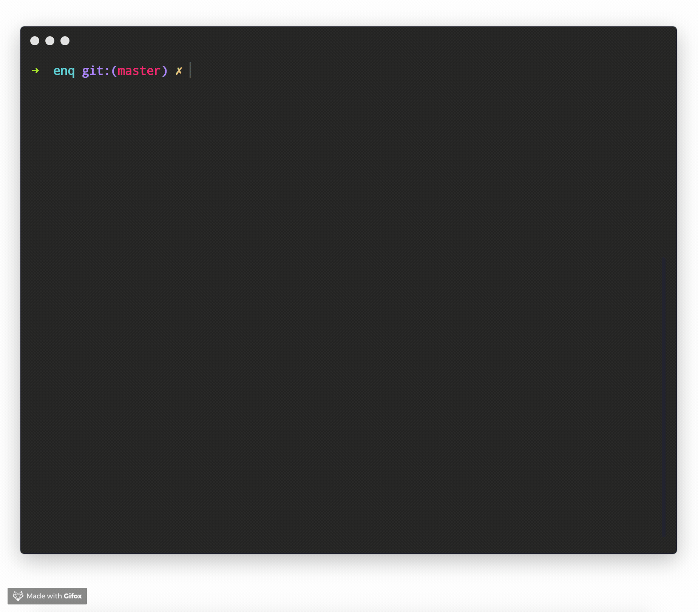

# iterm-monokai

<h1 align="center">iTerm Monokai - Theme</h1>

<p align="center">
  <b>Enhanced monokai theme for <a href="https://iterm2.com/">iTerm2</a>.</b>
</p>

<p align="center">
  <br>
  <sub><a href="https://github.com/enquirer/enquirer">Enquirer</a> Survey Prompt, using iTerm2 Monokai Theme</sub>
</p>

> Customized monokai theme for iTerm2. There are others, this one is based on [monokai-extended](https://github.com/jonschlinkert/sublime-monokai-extended).

## Install

**1. clone**

```sh
$ git clone https://github.com/jonschlinkert/iterm-monokai.git
```

**2. activate**

Open the `monokai.itermcolors` file to install.


## Alternatives

Don't like this one? Try one of these:

- https://github.com/deepsweet/Monokai-Soda-iTerm
- https://github.com/episko/iterm2-monokai
- https://github.com/stephenway/monokai.terminal

## Contributing

Pull requests and stars are always welcome. For bugs and feature requests, [please create an issue](https://github.com/jonschlinkert/monokai/issues/new).

## Author

**Jon Schlinkert**

+ [github/jonschlinkert](https://github.com/jonschlinkert)
+ [twitter/jonschlinkert](http://twitter.com/jonschlinkert)

## License

It's been a while since I first created/customized this theme, so I'm not 100% sure but I believe it was first based on [monokai.terminal](https://github.com/stephenway/monokai.terminal) by [@stephenway](https://github.com/stephenway).

Following in Stephen's footsteps, this has no license, feel free to use as you want.